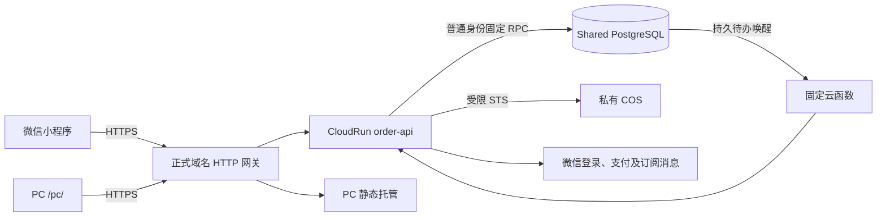

# 在线点单系统技术文档

## 1. 技术目标

系统服务于 500 人以内的政府/企业餐饮点单场景，核心要求是稳定、清晰、可维护。技术设计应优先保证下单、支付回调、订单核销、后台管理这些关键链路可靠。

## 2. 一期生产架构基线

本节只描述已确认的生产架构和业务边界；具体操作、发布顺序、失败处理及回滚统一见[生产 Runbook](../../deploy/runbooks/order-production-release.md)。版本与部署结果以其中的精确 SHA 和实际回执为准，不从设计文档推断验收完成。

### 2.0 当前实现与交付边界

生产采用 CloudBase / CloudRun + Shared PostgreSQL + 私有 COS。此前仅实现匿名目录的阶段说明已过期；本节不维护另一份部署进度表。图片去除原生版本号依赖属于本次本地适配，尚未发布，不能据此直接更改已部署版本的存储配置。历史 UAT 版本策略及回执不改写。

### 2.1 组件与数据流

数据库保存交易、权限、审计及待办事实，COS 保存图片二进制。CloudRun 实例不保存业务事实。PC 唯一入口是正式域名 `/pc/`，不保留旧路径。Realtime 不是当前生产运行依赖。

### 2.2 同步交易与事实源

同步写请求先鉴权并校验输入和幂等键，再通过固定 RPC 在同一个 PostgreSQL 事务内更新业务状态、审计及必要异步意图。事务提交后才调用外部系统；外部网络调用不得位于数据库事务内。

预支付先持久化预支付记录和唯一 `out_trade_no`，只有服务端确认微信支付成功才生成订单。响应丢失或进程中断时收敛同一交易，避免重复扣款。商品可售性按现行 PRD 的上下架、取餐日期售罄、截单及营业规则校验；不恢复已废止的数量库存或软预占。

### 2.3 回调、通知与可靠补偿

支付和退款回调先验签、解密并验证交易归属，再持久化去重观察；持久化失败不得确认成功。通知意图随业务事务持久化，首次发送及时执行。

补偿只登记真实异常；失败后 30 分钟重试，成功停止，永久错误或需人工处理的结果停止自动重放。领取、租约和执行结果由数据库保存，外部调用在事务外执行；须验证重启和多实例接管，不能以进程 timer 冒充可靠恢复。当前生产按记录持久唤醒，不启用支付、退款和通知的每秒全表扫描。

自动进入制作中由服务器时间派生；取消须在事务内确认距取餐严格大于 30 分钟。列表、详情、筛选和统计保持相同边界。

### 2.4 数据库迁移与发布顺序

唯一执行入口是[生产 Runbook](../../deploy/runbooks/order-production-release.md)。关系迁移与函数安装从最终候选分别生成，核对定义、ACL/RLS、普通身份及账本。已执行成功的迁移不得重复；结果未知先只读核实。启动不自动迁移、不自动 down。回退只采用与当前数据库兼容的应用版本、forward fix 或已验证恢复。

### 2.5 环境、配置与密钥

UAT 与 Prod 使用独立 CloudBase 环境、Shared PG、数据库身份、COS 桶及受限访问身份、域名与回调配置。已确认的小程序 AppID 和商户归属不因技术适配更换；共享平台账号时仍须校验交易环境。生产不复制 UAT 示例数据或凭据。

运行材料通过 CloudRun 受保护配置注入。业务使用普通数据库身份与固定 RPC，COS 使用限定 Prod 桶及前缀的 STS。密钥不进入客户端、源码、镜像、文档或日志；必要材料缺失时不能伪装运行成功。

### 2.6 COS、HTTPS 与安全边界

COS 保持私有，禁止匿名读取和列举。服务端生成唯一对象路径，授权上传并校验内容类型、大小及摘要，确认后保存对象引用；读取使用短期签名 URL。本次 Prod 目标是唯一对象路径和禁止覆盖，不要求原生版本控制、历史版本保留或图片误删恢复。相关代码与 SQL 适配发布并验证前，不将此目标当作线上已生效。

正式 HTTPS、域名绑定及小程序合法域名按 Runbook 核验；网站 ICP 与小程序备案分别核实。图片缩略与加载性能依据实际体积、耗时验收，涉及新增费用先确认。

### 2.7 核心数据备份与恢复

保留 PRD §9.5 的核心数据备份与恢复演练方案。采用当前 Shared PG 实际支持且已授权的路径，记录恢复点、数据缺口、恢复耗时和订单/支付/退款/核销/审计一致性。不强制未由 PRD 约定的 PITR、固定保留天数、季度频次或 RPO/RTO 数值，不因此采购独享资源。没有恢复实证时如实标记，不把导出成功或本地演练当作线上已可恢复。

### 2.8 日志、异常与费用检查

保留脱敏结构日志和关键操作审计，支持查询支付、退款与通知异常。不得记录请求正文、Authorization、Cookie、个人信息、回调原文或凭据。不强制开通 CLS、CAT 或额外日志保留套餐，不把无 PRD 依据的整套固定监控阈值作为上线门禁。预算、费用开关和证书现状按 Runbook 核验；新增费用先取得授权。

### 2.9 容量验证

按 PRD §9.2 的实际规模验证：5–10 分钟集中 100–300 单、日 500–1000 单，核心交易不被统计阻塞。验证重复提交、资金幂等及权限等业务不变量。不追加 200 并发、300 商品、固定 p95 或库存指标。记录实际规格与测量结果；若不足先定位瓶颈，涉及资源升级或费用另行确认。

### 2.10 本阶段非目标

不恢复旧 CVM / Nginx / systemd / MySQL / SSM 发布路线，不新增 Redis、MQ、独立微服务、跨地域灾备或 7×24 人工值守。本文不提供第二套采购、安装或切流步骤。

## 3. 核心模块

### 3.1 用户模块

职责：

- 微信登录或手机号授权。
- 记录用户身份。
- 区分员工和访客。
- 控制用户只能查看自己的订单。

主要数据：

- 用户 ID。
- 微信 openid。
- 手机号。
- 姓名。
- 员工/访客类型。

### 3.2 商品模块

职责：

- 商品分类管理。
- 商品 CRUD。
- 商品图片管理。
- 商品上下架。
- 售罄和库存管理。
- 价格和规格管理。

关键规则：

- 用户下单时以后端实时价格为准。
- 订单创建后需要固化商品名称、价格、数量和图片快照。
- 下架商品不在用户端展示。
- 售罄商品可展示但不可购买。

### 3.3 订单模块

职责：

- 创建订单。
- 管理订单状态。
- 生成系统订单号、取餐号和核销二维码。
- 处理取消、退款、完成。
- 支持后台查询和导出。

生产订单九态：

- 待支付。
- 已支付待接单。
- 制作中。
- 待取餐。
- 已完成。
- 已取消。
- 退款中。
- 已退款。
- 异常。

### 3.4 支付模块

职责：

- 调用微信支付创建支付单。
- 接收微信支付回调。
- 更新订单支付状态。
- 记录微信交易号。
- 支持退款申请和退款状态记录。

关键规则：

- 支付回调必须幂等。
- 订单支付状态以服务端和微信支付结果为准。
- 不依赖前端跳转结果判断支付成功。
- 资金进入餐饮企业微信支付商户号。

### 3.5 核销模块

职责：

- 生成核销二维码 token。
- 支持扫码核销。
- 支持手动输入订单号或取餐号核销。
- 记录核销人、核销时间、核销方式。

关键规则：

- 已完成订单不可重复核销。
- 已取消、已退款订单不可核销。
- 核销 token 不能直接暴露敏感信息。
- 核销接口必须幂等。

### 3.6 后台权限模块

生产后台只使用四角色：

- 店管：商品、员工名单、员工价、营业预约设置、订单、全额退款和基础看板。
- 后厨：查看履约必要信息并执行接单、制作和备好。
- 核销：查看待取餐必要信息并执行扫码或手工核销。
- 财务只读：只查看支付、退款、结算和导出。

角色和资源权限由服务端执行；开发人员不默认持有常驻生产业务角色。

### 3.7 统计模块

职责：

- 统计每日营收。
- 统计订单量。
- 统计访问和点击。
- 统计单品销量和销售额。
- 支持按日期、餐段、分类、商品筛选。

规则：

- 财务类数据以支付成功和退款结果为准。
- 浏览和点击数据只作为运营参考。
- 统计可以异步计算，不阻塞下单主流程。

## 4. 关键数据表建议

### 4.1 用户表 `users`

- id
- openid
- phone
- name
- user_type
- status
- created_at
- updated_at

### 4.2 商品分类表 `product_categories`

- id
- name
- sort_order
- status
- created_at
- updated_at

### 4.3 商品表 `products`

- id
- category_id
- name
- description
- image_object_key
- price
- sales_status
- sort_order
- created_at
- updated_at

### 4.4 订单表 `orders`

- id
- order_no
- pickup_no
- user_id
- user_name
- user_phone
- total_amount
- pay_amount
- order_status
- pay_status
- pickup_location
- remark
- created_at
- paid_at
- completed_at

### 4.5 订单明细表 `order_items`

- id
- order_id
- product_id
- product_name_snapshot
- product_image_snapshot
- unit_price
- quantity
- subtotal_amount

### 4.6 支付记录表 `payment_records`

- id
- order_id
- order_no
- payment_channel
- wx_transaction_id
- amount
- status
- paid_at
- callback_event_id

### 4.7 退款记录表 `refund_records`

- id
- order_id
- refund_no
- amount
- reason
- audit_status
- refund_status
- auditor_id
- audited_at
- created_at

### 4.8 核销记录表 `verification_records`

- id
- order_id
- pickup_no
- verifier_id
- verify_method
- verified_at

### 4.9 操作日志表 `operation_logs`

- id
- operator_id
- operator_role
- action
- target_type
- target_id
- detail
- created_at

## 5. 订单编号规则

系统需要同时有系统订单号和取餐号。

- 系统订单号：用于唯一识别、支付和对账，例如 `YYYYMMDDHHmmss + 随机数`。
- 取餐号：用于窗口取餐，例如每日递增 `A001`、`A002`。
- 二维码内容：使用核销 token，不直接暴露用户手机号、姓名等信息。

要求：

- 系统订单号全局唯一。
- 取餐号在同一天、同一门店或同一餐段内不可重复。
- 已取消订单的取餐号不复用。

## 6. 核心接口建议

用户端：

- 登录。
- 获取首页信息。
- 获取商品分类。
- 获取商品列表。
- 获取商品详情。
- 创建订单。
- 发起微信支付。
- 查询订单列表。
- 查询订单详情。
- 申请取消或退款。

后台端：

- 后台登录。
- 分类管理。
- 商品管理。
- 商品上下架。
- 商品售罄。
- 订单查询。
- 订单详情。
- 订单核销。
- 退款审核。
- 数据看板。
- 营业设置。

支付回调：

- 微信支付成功回调。
- 微信退款结果回调。

## 7. 稳定性要求

- 创建订单接口需要防重复提交。
- 支付回调需要幂等。
- 核销接口需要幂等。
- 下单时必须重新校验商品状态、当日售罄、价格、截单和营业状态。
- 统计数据异步处理，避免影响下单。
- 后台关键操作写入操作日志。
- 异常订单需要可查询、可追踪、可人工处理。

## 8. 安全要求

- 支付参数、密钥、证书只存服务端。
- 用户只能访问自己的订单。
- 后台接口需要鉴权。
- 不同后台角色只能访问授权功能。
- 二维码 token 需要随机性或签名。
- 敏感操作需要记录操作人和时间。

## 9. 容量口径

容量以 PRD §9.2 为准：5–10 分钟集中 100–300 单、日 500–1000 单。验证边界见 2.9 节；在取得实际证据前，不声称具体资源规格已经满足要求。

## 10. P0 原型技术建议

P0 原型优先目标是展示交互，不是完成生产系统。

建议：

- 使用静态页面或轻量前端项目实现。
- 使用 mock 数据模拟商品、订单、用户、营收。
- 模拟微信支付成功。
- 模拟二维码和核销成功。
- 页面结构尽量贴近后续正式开发，避免原型完全推倒重来。

P0 不需要：

- 真实微信支付。
- 真实数据库。
- 完整权限系统。
- 真实库存扣减。
- 正式部署上线。

## 11. 后续开发注意事项

- 先确定客户对 P0 页面和流程的认可，再进入正式开发。
- 支付、退款、核销属于高风险链路，需要优先做技术验证。
- 商品价格、订单金额、支付金额必须以后端数据为准。
- 统计口径需要提前固定，避免上线后经营数据产生争议。
- 一期只实现已归档的单门店、单取餐点模型；新增门店、窗口或档口必须先完成独立产品与架构 change，不在当前数据模型预留隐藏行为。
